# Hardware: the single Pithos unit (bottom-panel pull-fan cooling) and clustering atomic units

**Status: DRAFT for owner review. Not committed, not pushed, no issues filed.**

This draft extends [HARDWARE.md](HARDWARE.md). Pithos is built from **one atomic unit**: **one BC-250 in one hard case** (an **unmodified** nyacom FlexATX case inside an **Apache 5800** hard case). The board keeps only **one fan**, and the hard case gets its own **pull fan on its vented bottom panel** so it runs **closed**. Everything else is as in HARDWARE.md.

**Clustering is optional and is done with units, not with bigger cases.** A single board in its case is a complete, useful system on its own. Two units cluster over a **1G direct Cat6 cable between the boards' onboard 1G ports** (llama.cpp RPC); each board's **Wi-Fi 7 adapter** carries the LAN. **USB 5GbE adapters** (ULANSeN, Realtek RTL8157; about 60 USD for a pair, plus cable) are an **optional upgrade** if 1G prompt prefill is too slow. **Three or more units** use those adapters plus a switch that really negotiates 5GBASE-T (options below). **Never run cluster traffic over Wi-Fi.** A larger case holding two boards was considered and dropped (see "Considered and dropped: dual-board case").

**Guiding philosophy.** Pithos aims to get capable local AI into people's hands at the lowest practical cost and power, and to open-source the docs, BOMs, scripts, diagrams and case measurements so anyone can copy, print or build their own. Raw speed comes after cost, power and ease of setup. Anything that adds cost (5GbE adapters, a switch, a CU unlock, a nicer case) stays optional.

Legend (same as HARDWARE.md): **[UNVERIFIED]** = not confirmed on a built unit. **[EST]** = estimate from stated inputs, not a measurement. **TBD** = no verified part, link or price yet. **[INFERRED]** = read from photos or STL files, not confirmed by the designer. **[MEASURED]** = taken from nyacom's STL files (`tools/nyacom_measure.py`). Prices were read from the linked pages on **Nov 17, 2026** and move constantly.

## Design in one page

- **The nyacom case stays unmodified.** Its case-fan opening and its slotted exhaust are on the **same face** (the "shared face"). Both are now **[MEASURED]** from the STL files: a **Ø118 mm** fan opening 265 mm from the I/O end and **eight slanted 76 x 6 mm slots** (the "neo" cover) that together are only **35.9 cm2 open**.
- **One vented panel: the base's bottom panel.** The nyacom case sits with its **shared face pressed flat against the INSIDE of that panel** on thin **3 mm bumper pads** (vibration only, **no seal**), held there by printed hold-down brackets on the long sides. Cut only **one round fan hole** and **intake window A** over the case-fan opening (plus a small cabin make-up window B). The lid is **not** cut, so it stays usable as the NexDock/keyboard shelf.
- **Pull fan bolted directly to the OUTER face of the panel** over the round hole, **no internal shunt, hood or collar**. The part of the slot field outside the hole is simply **blocked by the panel**. Push/pull: the board's heatsink fan **pushes**, the Noctua **pulls**.
- **The fan is the Noctua NF-A14x25 G2 (140 mm) on a Ø130 mm hole**, not the biggest fan that fits. The 200 mm NF-A20 also fits the Apache 5800 floor, but the slots restrict the flow so much that the G2's pressure wins (about **24 CFM vs 18 CFM** for the pull fan alone [EST]); the Ø130 hole still exposes **86%** of the slot area. See "Pull fan".
- **There is no real seal anywhere.** The pull fan draws air out of the **whole enclosure** (case air, PSU heat) through the open slots and the gaps, and make-up air leaks in through windows A and B. Whether that clears the PSU heat is a **test item**.
- **Cable clearance at the ends:** **80 mm at the I/O end and 95 mm at the PSU/AC end** on the Apache 5800 (**60 / 55 mm minimum**, which is all the Apache 4800 can give). The brackets sit on the long sides only.
- **The only shunt is outside:** a printed **external deflector hood** over the fan. It sends the hot exhaust away from the intake windows and doubles as the rain-shed and the transport-cap mount.
- **Orientation.** Closed and running, the case **lies on its lid, panel UP**. **Upright**, the lid drops down as a NexDock or keyboard shelf and the panel faces **sideways**: keep **100 mm or more [EST]** clear around the hood outlets. Panel facing down is not supported.
- **Waterproofing is not a goal.** The target is **dust plus light splash/drip resistance**: washable filters, fan grill, hood, louvered intake hoods and **magnetic transport caps** that close every opening when packed, with a **reed-switch interlock** so the board cannot be powered with a cap on.
- **Brand rule (owner):** no Chinese-headquartered hardware brands for network gear; see "Brand check".

## Diagrams (D2 sources and render commands)

The **D2** sources (https://d2lang.com) are the primary diagrams; the to-scale floor plans and section are generated by `tools/make_svgs.py` (D2 has no coordinates).

| Diagram | Single unit | Cluster |
|---|---|---|
| Floor plan (schematic, D2) | [d2-single-layout.d2](diagrams/d2-single-layout.d2) | [d2-cluster-two-units-layout.d2](diagrams/d2-cluster-two-units-layout.d2) |
| Floor plan and section (to scale) | `single-layout-top.svg` (Apache 5800), `single-layout-top-apache4800.svg`, `single-airflow.svg` | `single-cluster-two-units-layout.svg` |
| Airflow path (D2) | [d2-single-airflow.d2](diagrams/d2-single-airflow.d2) | per unit, as the single unit |
| Power wiring (D2) | [d2-single-power.d2](diagrams/d2-single-power.d2) | per unit |
| Cap interlock logic (D2) | [d2-interlock.d2](diagrams/d2-interlock.d2) | per unit |
| Network (D2) | [d2-single-network.d2](diagrams/d2-single-network.d2) | [two units, 1G direct cable (default)](diagrams/d2-cluster-two-units-network.d2); [three units via a switch](diagrams/d2-cluster-three-units-network.d2) |

Render (needs the `d2` CLI; install with `curl -fsSL https://d2lang.com/install.sh | sh -s --`):

```bash
cd docs/diagrams
d2 --layout=dagre d2-single-power.d2 d2-single-power.svg      # one diagram to SVG
d2 --layout=dagre d2-single-power.d2 d2-single-power.png      # one diagram to PNG
../../tools/render_diagrams.sh                                 # all D2 diagrams (SVG + PNG) and the to-scale plans
python3 ../../tools/airflow_calc.py                            # airflow and fit numbers
python3 ../../tools/nyacom_measure.py                          # downloads nyacom's STLs and prints every measured number below
```

## Machine-readable summary (for agents)

```yaml
doc: HARDWARE-SINGLE
unit: "one BC-250 in one unmodified nyacom FlexATX case inside one Apache 5800 hard case; cluster by pairing units"
design: "shared face pressed on the INSIDE of the vented BOTTOM panel on 3 mm bumper pads (vibration only, no seal); Noctua pull fan bolted directly to the OUTER face over a round hole; NO internal shunt/hood/collar; the only shunt is an external printed deflector hood; push (case fan) / pull (Noctua)"
nyacom_measured_from_stl:   # source https://www.printables.com/model/1737913 (CC BY-NC-SA), tools/nyacom_measure.py
  outer_mm: "175 x 125 x 339 (width x thickness x length)"
  length_stack_mm: "I/O panel 12 + front body 190 + rear body 125 + rear panel 12 = 339 (327 not supported)"
  case_fan_opening: "circle D118 mm, 10,931 mm2, centre 265 mm from the I/O end (74 mm from the PSU end), centred across the width"
  neo_slots: "8 slanted slots 76 x 6 mm, 30 deg off the width axis, 18 mm pitch, centres 43.5..169.5 mm from the I/O end, field 167 x 66 mm, open area 3,588 mm2 (35.9 cm2) = 32% of the field bbox"
  classic_cover_open_cm2: 87.5
  front_panel_open_mm2: 6138   # port window 44 x 114.5 mm (3,432 mm2) plus slots and honeycomb
nyacom_printed_kit: "https://www.ebay.com/itm/236997099720?var=537406080449"  # seller's printed kit, slotted-cover variant; buying it supports the seller
pull_fan: "Noctua NF-A14x25 G2 PWM 140 mm (Amazon B0DDY14DQD, 44.95), Ø130 mm hole centred on the slot-field centroid; 86% of the neo slot area exposed"
airflow_estimate_cfm: {pull_fan_alone_neo_cover: 23.7, pull_fan_alone_classic_cover: 41.9, note: "EST; the case fan in series adds to this; closed-case tests decide"}
case: "Apache 5800 (Harbor Freight 64819), interior 514 x 289 x 144 mm, 89.99 USD (verified); free length 175 mm = I/O 80 + PSU 95; stack 128 of 144 mm"
alternatives: ["Apache 4800 (64250, 59.99, 454 x 327 x 168): zero length margin even at the 60 + 55 mm minimums", "NANUK 935 (Canada, 219.95): 521 x 287 x 191, base 137 mm, +7 mm margin at 80 + 95"]
intake_windows: "A 105 x 105 mm over the case-fan opening, B 80 x 80 mm cabin make-up; washable 120 mm filters"
outside_protrusion_mm: "about 89 (fan 25 + guard 4 + hood 60)"
psu: "Apevia ITX-PFC500W"
ac_inlet: "1x fused C14, T6.3A"
caps_and_interlock: "3 transport caps, 3 reed switches in series with PS_ON"
bom_verified_subtotal_usd: 318.28   # rows 3-18, excludes board, nyacom kit, TBD items
bom_csv: diagrams/bom-single.csv
cluster:
  default_two_units: {link: "1G direct Cat6 between the onboard 1G ports (via the LAN jacks)", lan: "each board's Wi-Fi 7 adapter", switch: none, addon_usd: 6.39, two_units_plus_addon_usd: 572.16}
  optional_5gbe_two_units: {link: "USB 5GbE RTL8157 (ULANSeN / Realtek) plus Cat6", addon_usd: 78.95, addon_usd_if_reusing_1g_cable: 72.56, note: "upgrade only if 1G prefill is a problem; about 60 USD for a pair of adapters, plus cables"}
  three_plus_units: {switch: "Ubiquiti USW-Flex-XG (4 x 10GbE RJ45, each does 5G, fanless, 25 W max), 299.00", link: "USB 5GbE adapters plus the switch", addon_usd_three_units: 427.01}
  never_cluster_over_wifi: true
  model_target: "Qwen3.6 35B MoE, about 23 GB Q4"
  bom_csv: diagrams/bom-cluster-addon.csv
power_estimate:
  apu_under_load_w: "110-112 (amdgpu_top snapshot, one board, during generation)"
  wall_under_load_w: "130-145 [EST]"
  note: "estimates pending plug-in wattmeter measurement of idle and load; chip-reported power is not wall draw"
estimates_marked_EST: [end_clearance_plug_sizes, heat_load, cfm_needed, fan_curve_and_cd, tcp_throughput, power_budget, filter_open_area, wall_clearance, psu_loss, wall_power_from_amdgpu_top_snapshot]
unverified: [mirror_orientation_of_slots, case_fan_curve, apache5800_handle_channel_and_lid_split, closed_case_temperatures, external_recirculation, cabin_and_psu_heat_clearing, hold_down_brackets, rtl8157_on_bc250_usb3, apevia_reliability, reed_interlock_wiring, nyacom_mounting_holes]
```

## What "case" means here

The enclosure is a hard carry case (**Apache 5800**, Harbor Freight, interior **514 x 289 x 144 mm**) holding a **nyacom FlexATX case** (3D printed; free STLs at [Printables model 1737913](https://www.printables.com/model/1737913), CC BY-NC-SA; or [buy the seller's printed kit, slotted-cover variant](https://www.ebay.com/itm/236997099720?var=537406080449)) that contains the **BC-250** and the **Apevia ITX-PFC500W** PSU. "Single fan" means the **one ARCTIC P12 Pro PST in the nyacom case** that pushes air through the stock BC-250 heatsink (many builders add a second push-pull fan; this build does **not**). The **outer pull fan** is separate: it bolts to the **outside** of the hard case's bottom panel over a round hole and pulls the exhaust out of the nyacom case through it.

---

## The nyacom case, measured from the STL files

**Source:** nyacom, [Printables model 1737913](https://www.printables.com/model/1737913), CC BY-NC-SA 4.0 (non-commercial) for the **free STLs**. To buy a printed case and support the seller, use the [eBay printed kit, slotted-cover variant](https://www.ebay.com/itm/236997099720?var=537406080449) (the variant used in Pithos; price not checked here). The Printables page blocks plain page fetches, but the **public Printables GraphQL API** (`https://api.printables.com/graphql/`, `getDownloadLink` mutation, browser-like User-Agent) serves the free STL files. `tools/nyacom_measure.py` downloads them and reprints every number below (needs `trimesh`, `shapely`, `scipy`, `rtree`). The STLs are not copied into this repo.

Coordinates: the assembled case, x across the 125 mm thickness, **y along the 339 mm length from the I/O end**, z across the 175 mm width.

| Feature | Value | Status |
|---|---|---|
| Outer size | **175 (width) x 125 (thickness) x 339 (length) mm** | [MEASURED] bounding boxes of the parts below |
| Length stack | I/O (front) panel **12** + front body **190** + rear body **125** + rear panel **12** = **339 mm** | [MEASURED] the rear panel has a 2-3.5 mm inset lip over its last 4 mm, so about 335 mm at the very end |
| **339 vs 327 mm** | **339 is right.** The 327 mm figure came from assuming the rear panel overlaps the rear body; the STLs show the four parts end to end with no overlap. The lip trims at most about 4 mm. | resolved [MEASURED] |
| Shared face | The front-body cover plate (x -62.5 to -29.2) and the rear body (x -62.5) are **coplanar**: one flat 175 x 339 mm face | [MEASURED] (removes the earlier "cover not downloaded" assumption) |
| **Case-fan opening** | **Ø118 mm circle, 10,931 mm2**, centre **265 mm from the I/O end** (74 mm from the PSU end), **centred across the 175 mm width** | [MEASURED] |
| **Slotted exhaust ("neo" cover, 8 slots)** | **8 slots, each 76 x 6 mm** (448 mm2 each), long axis **30 degrees off the width axis**, **pitch 18 mm along the length** (solid bar between slots about 11 mm measured along the length). Slot centres 43.5, 61.5 ... 169.5 mm from the I/O end, centre line **110.5 mm** from one long edge (64.5 mm from the other). Field bounding box **167 mm (length) x 66 mm (width)**, from 23 to 190 mm from the I/O end | [MEASURED] |
| **Open area of the neo slots** | **3,588 mm2 = 35.9 cm2**, which is **32% of the 167 x 66 mm field box** and 26.5% of Stefan's 76 x 178 mm "3 in x 7 in" rectangle. The "7 in" is the **diameter of the smallest circle around the slanted field (178 mm)**; the "3 in" is the slot length | [MEASURED] |
| Slot field centroid (best centre of a round hole) | **106.5 mm from the I/O end**, **110.5 mm across** from one long edge | [MEASURED] |
| Classic cover (alternative printed part) | about **115 rectangular holes of 11.5 x 10.5 mm**, open **87.5 cm2** (about 59% of its 167.5 x 88 mm field), centred 15 mm to the other side of the width centre | [MEASURED] |
| 120fan cover (alternative) | **Ø118 mm opening**, about 110 cm2 | [MEASURED] |
| Front (I/O) panel | 12 mm thick, 125 x 175 mm. Open: **port window 44 x 114.5 mm (3,432 mm2)**, 16 slots of 13 x 3 mm (593 mm2), 16 honeycomb cells of about 12 x 10.5 mm (**1,493 mm2**), four corner notches; **total open 6,138 mm2**. The window sits off-centre (x -19.5 to 24.5, z -77.5 to 37) | [MEASURED] |
| Rear (PSU) panel | 12 mm thick, **79.2 x 40.5 mm** opening plus corner notches and pilot holes | [MEASURED] |
| Case-fan mounting (screw holes, leg holes, bracket points) | Blind features are not through-holes and were **not located** | not measured |
| Internal arrangement (board, PSU placement) | Drawn schematically | [INFERRED] |

**Round-hole coverage of the neo slots** (share of the 35.9 cm2 that a round hole centred on the slot-field centroid leaves open; the rest is blocked by the panel):

| Hole | 110 | 120 | **130** | 140 | 150 | 160 | 170 | 180 | 190 |
|---|---|---|---|---|---|---|---|---|---|
| Neo slots open through the hole | 72% | 80% | **86%** | 91% | 94% | 97% | 99% | 100% | 100% |
| Open area (cm2) | 25.9 | 28.9 | **30.9** | 32.6 | 33.7 | 34.8 | 35.5 | 35.9 | 35.9 |

For the **classic cover** a Ø130 hole exposes **63.9 cm2 (73%)** when centred on that cover's own field (about **2x the neo open area**). The classic field sits on the **other side** of the width centre (about 15 mm off centre vs the neo field's 23 mm), so a hole cut for the neo cover would expose only about **44.9 cm2** of the classic cover: **cut the hole using the cover you will actually fit as the template**.

**The one real design finding.** Earlier drafts assumed the 76 x 178 mm field was a centred rectangle of 135 cm2 with about 50% bar-free area (about 68 cm2 open). The measured open area is only **35.9 cm2**, so **the slots, not the fan size, are the main restriction** in the whole airflow path. That is why the pull fan is chosen for pressure, and why the optional classic cover (below) is worth testing.

## Outer case: Apache 5800 baseline, re-checked

Free length = interior length minus the 339 mm nyacom case. Clearances are typical plug sizes **[EST]**, not measurements of the real cables:

| End | What plugs in | Minimum | Recommended |
|---|---|---|---|
| **I/O end** (BC-250 ports) | right-angle DP/HDMI adapter (35-45 mm), USB plugs, RJ45 with boot (about 45 mm) plus a 25 mm bend | **60 mm** | **70-80 mm** |
| **PSU / AC end** | C13 plug plus bend (30-50 mm + 25 mm), PSU fan needs about 20 mm of free air | **55 mm** | **75-80 mm** |

| Outer case (verified dimensions) | Interior L x W x H | Price | Free length | Margin over minimum (60 + 55) | Margin over recommended (80 + 95) | Stack 128 mm |
|---|---|---|---|---|---|---|
| Apache 4800 ([HF 64250](https://www.harborfreight.com/4800-weatherproof-protective-case-x-large-black-64250.html)) | 454 x 327 x 168 mm | 59.99 | 115 mm | **0 (zero spare)** | -60 | 40 mm spare |
| **Apache 5800 ([HF 64819](https://www.harborfreight.com/5800-weatherproof-protective-rolling-carry-on-case-x-large-64819.html)), baseline** | **514 x 289 x 144 mm** (20-1/4 x 11-3/8 x 5-11/16 in, listing "interior dimensions") | **89.99** | **175 mm** | +60 | **0** (80 + 95 as drawn) | 16 mm spare |
| NANUK 935 ([Amazon B08L9QB6XD](https://www.amazon.com/dp/B08L9QB6XD); made in Canada) | 521 x 287 x 191 mm, base 137 mm | 219.95 | 182 mm | +67 | +7 | 9 mm spare in the base |

- **Why the 5800 is the baseline.** The Apache 4800 only fits at the **minimum** clearances with right-angle plugs on both ends and **zero spare**. The 5800 costs **30.00 more** and fits at the recommended clearances; the 289 mm width leaves a **114 mm strip** beside the 175 mm nyacom case for window B and the hold-downs. The 4800 stays as the "tight alternative" drawing (`single-layout-top-apache4800.svg`). The NANUK 935 is the premium option (Canadian maker, 2x the price, a bit more length and a much deeper lid).
- **Rolling-case caveats [UNVERIFIED]:** the 5800 is a **rolling carry-on** (wheels, telescoping handle, zipped lid pockets in the photos). Whether the handle channel intrudes into the 514 mm interior length, whether the **lid/base split** leaves the 128 mm stack in the base (the interior depth is only 144 mm in total, 16 mm spare, so the nyacom case probably reaches into the lid cavity when closed), and the thickness and ribs of the real **bottom panel** are not published. Buy one, measure, then cut.
- The hold-down brackets sit on the **long sides** only; the C14 inlet sits on the **long side wall at the PSU end** so the C13 plug does not eat the 95 mm gap.
- Other cases (Apache 9800 rifle case, Pelican, Gator) were rejected earlier as oversized for one unit.

## How the vented panel is built

1. **Cuts in the bottom panel only** (the lid stays intact): one **round Ø130 mm hole** for the pull fan, **window A** (105 x 105 mm) over the nyacom case-fan opening, **window B** (80 x 80 mm, cabin make-up air, beside the nyacom case) and a **small grommeted hole** for the fan lead (TBD). Nothing else is cut.
2. **Pull fan bolted directly to the OUTER face of the panel**, blowing **away from the panel**. Four M4 screws pass hood foot, fan and panel, with low-profile nuts or inserts on the inside. **No collar, shunt or hood inside the case.**
3. **The nyacom case sits with its shared face pressed flat on the inside of the panel**, on four small **3 mm bumper pads** (about 25 x 25 mm, foam or rubber; **not a seal**, not a continuous frame). The hole centre is **106.5 mm from the I/O end of the case and 111.5 mm from one long edge**, i.e. the neo slot-field centroid (drawn in `single-layout-top.svg`). The hole does **not** have to line up with the case-fan opening.
4. **Hold-down brackets** (printed, bolted to the panel) sit on the two **long sides** (two per side), **never at the I/O or PSU end**, keeping the case on the bumper pads. With the panel up the case hangs under it, so the brackets carry its weight **[UNVERIFIED]**. Do not screw into the nyacom case. Mounting points of the nyacom case itself were not located in the STLs.
5. **Window A** (105 x 105 mm behind a 120 mm washable filter in a printed bezel) sits over the case-fan opening, so the **case fan draws mainly through window A**. **Window B** is the cabin make-up window.
6. **External deflector hood, intake hoods and caps** go on the outside (below).

Inside the base the stack is **nyacom 125 mm + 3 mm bumper pads = 128 mm** of 144 mm. **Outside** the panel, fan 25 + guard 4 + hood 60 add **about 89 mm**.

## Heat and airflow (all numbers are estimates)

All electrical power drawn at the wall ends up as heat inside a closed case. Scenarios: **about 132 W [EST]** (Bubo's 112 W GPU-side reading / 0.85 PSU efficiency), **280 W** (HARDWARE.md sustained inference), **370 W** (40-CU unlocked peak). Flow needed `CFM = 1.757 x W / dT`:

| Scenario | Heat | Needed at +10 K | Needed at +15 K |
|---|---|---|---|
| Low | 132 W | 23 CFM | 15 CFM |
| Design | 280 W | **49 CFM** | 33 CFM |
| Peak | 370 W | 65 CFM | 43 CFM |

**Wall power has not been measured on a built unit** (backlog: measure power draw per mode).

**Measured-power note [EST, pending measurement].** An `amdgpu_top` snapshot on a running board showed about **110-112 W** at the APU during generation. That is chip-reported power, not wall draw. PSU loss (roughly 10-15 %) plus the fans, SSD, Wi-Fi adapter and the board's power circuitry put the wall estimate at about **130-145 W** under that load (the 132 W figure above is 112 W / 0.85 PSU efficiency, at the low end of that band). Idle draw has not been measured and may be relatively high on these boards. Treat both figures as estimates until you meter them. For true system draw, leave a plug-in wattmeter (Kill-A-Watt style, or an energy-monitoring smart plug from a non-Chinese-HQ brand; **not** TP-Link Kasa) on the inlet for a day, and record idle and mid-generation watts separately.

### Pull fan: which size? (datasheets read on noctua.at, Nov 17, 2026)

The brief was "the largest fan that fits the bottom shell over the vent face". **A 200 mm fan does fit** the Apache 5800 floor (289 mm wide, hole Ø190 centred 117.5 mm from the wall, 6 mm clear of window A), and a Ø190 hole exposes **100%** of the slot area. But the slots are the bottleneck, so the fan has to push **through 35.9 cm2**. `tools/airflow_calc.py` solves a linear fan curve against the slot-exit loss (`dp = rho/2 (Q / (Cd A))^2`, Cd 0.65 [EST]):

| Fan (hole) | Free air | Max static | Pull fan alone, **neo** cover (30.9-35.9 cm2 open) | Pull fan alone, **classic** cover (63.9-87.5 cm2 open) | Rise at 132 W / 280 W (neo) [EST] |
|---|---|---|---|---|---|
| **NF-A14x25 G2 PWM, 140 mm (Ø130)** | 91.6 CFM | **2.56 mmH2O** | **23.7 CFM** | **41.9 CFM** | +9.8 K / +20.8 K |
| NF-A14 PWM, 140 mm (Ø130) | 82.5 CFM | 2.08 | 21.4 CFM | 37.8 CFM | +10.8 K / +23.0 K |
| NF-A20 PWM, 200 mm (Ø190) | 86.5 CFM | 1.08 | 18.4 CFM | 37.9 CFM | +12.6 K / +26.7 K |

- **Pick: NF-A14x25 G2 on a Ø130 hole.** It wins on pressure with the neo cover (+29% flow over the NF-A20), needs a smaller hole, is only 25 mm thick (89 mm outside protrusion vs about 99 mm) and still exposes 86% of the slots. The 200 mm NF-A20 is quieter (18.1 dB(A)) and only catches up with the **classic** cover, where open area stops being the limit. **This is a deliberate deviation from "largest fan that fits"; flagged for the owner.**
- **These are the pull fan's flow alone.** The ARCTIC P12 Pro **case fan is in series** through the same slots and **adds** pressure, so real flow should be higher; its curve is **unverified**. Treat 24 CFM as a floor, not the answer. At 132 W the pull fan alone gives about +10 K; at the 280 W design load the **neo cover alone is not enough** on this estimate (+21 K) and the **classic cover** is the fix (+11.7 K at 280 W).
- **Optional accessory (owner decision): print nyacom's classic cover** (his own part, same plane, no change to the case body) instead of the neo cover. It more than doubles the open area (about 64 cm2 through a Ø130 hole) at the cost of nyacom's neo look and any dust/finger protection the narrow slots give. Which cover Stefan's printed case actually has is **unconfirmed**; the slot length (76 mm) matches the neo cover.
- **Noise:** the nyacom P12 Pro at full speed (about 51 dB at 30 cm) dominates, not the Noctua. Powering: each Noctua runs from the PSU's 12 V through a **Molex-to-fan lead** ([OPSFALCON 2-pack, 7.99](https://www.amazon.com/dp/B07JHDQPQN)); no PWM wire, so full speed **[UNVERIFIED on this lead]**. Do not use the Low-Noise Adaptor on the full-load fan.
- **Failure.** A stalled pull fan sits in the only exhaust path and chokes airflow. An **optional tach or over-temperature watchdog** (BOM row 28, nice to have, TBD) would alert you; the board's own thermal throttle still applies. Test the fan-fail case (test 6).

**Intake.** Window A (105 x 105 mm, about 77 cm2 free at 70% open filter [EST]) takes the whole case-fan flow, about 2.5 m/s at 40 CFM. Window B (80 x 80 mm, about 45 cm2) is the make-up window. The measured **case-fan opening is 10.9 cm2 (Ø118)**, so window A is not the limit.

**What this does not prove.** The air must cross the stock heatsink; the BC-250's GDDR6 and VRM have **no sensors**; nyacom's tests were open-air at 28 C ambient (GPU 76 C at 24 CU, 85 C at 40 CU). **Closed-case temperatures are unmeasured.** Treat the design as a hypothesis to test.

### External deflector hood (the only shunt) and recirculation

A printed (PETG/ASA) hood is bolted over the pull fan's outer face on the fan's own four screws, with the 4 mm guard under it. It is **closed on top** (rain shed), has **baffle walls on the side that faces window A** and is **open on two sides (-x toward the I/O end, -y toward the near wall)**, **2 x 140 x 60 = 168 cm2** of outlet (0.8 m/s, 0.35 Pa at 27 CFM: negligible). Keep the outlet at least about 110 cm2 and do not put a filter on it. It doubles as the transport-cap mount (the exhaust cap closes the outlet) and holds that cap's reed switch.

- **Window A** sits 36 mm from the fan frame on the case-fan opening and pulls anything within about 100 mm of its face, so the exhaust must not blow toward it. The outlets face away (-x and -y); the +x baffle blocks line of sight.
- **Window B** (cabin make-up) is beside the case on the +y side, behind the hood's +y baffle.
- The exhaust is about +10 K at the low load. With the panel **up** it rises away from the intake hoods (about 26 mm tall). With the panel **sideways**, rotate the hood so an outlet points world-up.
- **Test thresholds [suggested]:** intake air at window A and B no more than **+2 K** above room temperature under load; if it is, lengthen the baffles, lower the outlet toward the wall or raise the hood.

## Vent and fan covers: dust, splash and drip protection

**Not a goal: waterproofing.** Cutting the bottom panel trades the case's IP65 sealing for airflow. The covers target **dust and light splash/drip**. **The Noctua fans are only IP50**, so they stay under a hood and out of rain.

| Function | Part | Source and status |
|---|---|---|
| **Washable filter on intakes** | F&Y 120 mm filters, magnetic frame, 4-pack, 105 mm hole spacing | [Amazon B0F5P68T6T](https://www.amazon.com/dp/B0F5P68T6T), **11.56 verified**. The panel is polypropylene (not magnetic): screw or glue the frame to the printed bezel. Open area not stated. Two windows per unit (plus spares). |
| Filter on the exhaust? | **None**, on purpose | The slots already use most of the fan's pressure. |
| **Fan grill / guard** | Noctua NA-FG1-14 Sx2 (140 mm) | [Amazon B0B2158PLM](https://www.amazon.com/dp/B0B2158PLM), **14.90 verified**. One pack covers two units. |
| **External deflector hood = rain-shed exhaust cover** | **140/120 mm Unrestricted Fan Rain Shroud** (MakerWorld): "places no obstructions near the fan blades while still blocking rain to an extreme angle", 52 g (140) / 31 g (120), no supports | [MakerWorld 3275345](https://makerworld.com/en/models/3275345-140-120mm-unrestricted-fan-rain-shroud), **page read**. Starting point for the hood (**two open sides, at least 110 cm2, baffle toward window A**); the 120 version fits over each intake window. |
| | Other candidates | Thingiverse [120mm fan housing with louvers](https://www.thingiverse.com/thing:3217414) (page read). Printables [Rain Cover for Computer Fan 1064048](https://www.printables.com/model/1064048-rain-cover-for-computer-fan), [120mm Fan Vent Hood 54490](https://www.printables.com/model/54490-120mm-fan-vent-hood), [120mm Angular Louvre Fan Grill 367734](https://www.printables.com/model/367734-120mm-angular-louvre-fan-grill): titles only, pages returned 403/500, **dimensions UNVERIFIED**. |
| **Snap-on / magnetic transport caps** | Printed plates (PETG) with 8 x 2 mm magnets in pockets, mating magnets in each hood or bezel rim, foam seat, a bright "REMOVE BEFORE POWER-ON" tag | Magnets: [rhinocats 8 x 2 mm, 100 pack, 8.99 verified](https://www.amazon.com/dp/B0DMDVMWLS). Plates: **TBD (to be modelled)**. **3 caps per unit** (exhaust, intake A, intake B). |
| **Remove-before-power-on interlock** | One **MC-38 magnetic reed switch** per cap, in **series** with the board's PS_ON latching switch (PS_ON to GND) | [uxcell MC-38 **NO** 3-pack, 16.29 verified](https://www.amazon.com/dp/B07F669GD1). NO = **open while the magnet is near**: a fitted cap breaks PS_ON-to-GND, so the PSU **cannot start**. Rated 0.5 A, about 10 mm actuation. **Check the contact state with a multimeter before relying on it**; keep the visible tag too. |
| **Feet / bumpers** | Self-adhesive rubber bumpers, 1 in square, 60-pack | [PHS, Amazon B01N25G0NV](https://www.amazon.com/dp/B01N25G0NV), **21.86 verified**. Four on the **lid** (the case rests on it); optional standoffs on the panel for upright use. |
| Connectors | RJ45 bulkheads have caps ([UMLIFE](https://www.amazon.com/dp/B07V317BYF)); the C14 inlet needs a splash cover **TBD** | Existing BOM rows. |
| Bumper pads (not a seal) | 3 mm closed-cell foam or rubber sheet | **TBD**, optional. Four small pads between the nyacom face and the panel. |

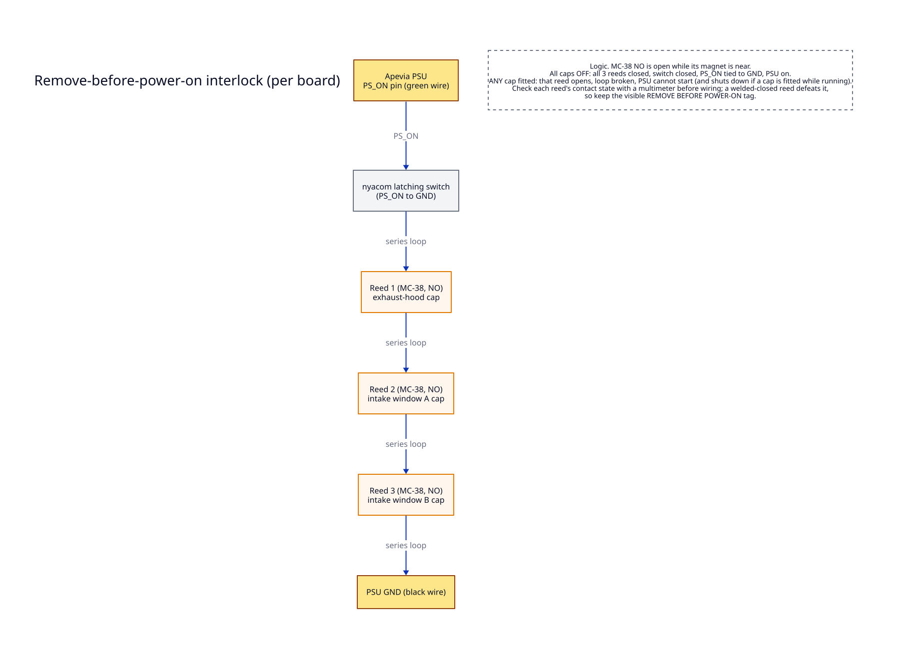

D2 source: [d2-interlock.d2](diagrams/d2-interlock.d2)

**Protection level, honestly.** No real seal exists in the airflow path, so dust control comes only from the filters on windows A and B. A hood, grill, filter and cap stack gives dust and drip protection. It does **not** make the cut panel water-tight. Keep the caps on whenever the case is packed and not running.

---

## Changes from the current single design (HARDWARE.md)

| Area | Current docs (HARDWARE.md) | This draft | Why |
|---|---|---|---|
| Board cooling | "120 mm high-static-pressure PWM fan(s) and filters, per the nyacom design" | **Exactly one** ARCTIC P12 Pro PST in the nyacom case. Do **not** use the **LN** variant. | nyacom's test: the P12 Pro baseline held 84 C GPU (40 CU, FurMark, 28 C ambient) while the LN version hit about 99 C and the test was stopped. |
| Case exhaust | "Lid intake and exhaust ports with filters, plus printed plenums" (size TBD) | **Bottom panel only**: the nyacom face is pressed on the **inside** of the panel, **one Noctua NF-A14x25 G2 pull fan** bolted to the outer face over a Ø130 mm hole, plus **two intake windows**. An **external printed deflector hood** is the only shunt. The **lid is not cut**. | Active exhaust draws from the whole enclosure, so the closed case has a path out. |
| nyacom case | (not specified) | **Unmodified.** | Owner decision. |
| Panel cut-outs | "Lid fan ports allow lid-closed running" (Apache 4800) | **[UNVERIFIED]** The Harbor Freight listings do **not** mention fan ports; both Apaches are **IP65**. Plan on **cutting** the bottom panel. | Read the product pages Nov 17, 2026. |
| Intake/exhaust spacing | "300 mm or more apart, with a divider" | **Replaced** by no internal divider, no real seal, and an external hood whose outlets face away from the windows. Recirculation is a **test item**. | One shared face makes 300 mm spacing impossible. |
| Mains inlet, PSU, RJ45 bulkhead | Fused C14, Apevia ITX-PFC500W, "RJ45 bulkhead (with cap)" | Unchanged, now with named parts (see BOM) and a PSU reliability caution. | |
| Covers | "Printed plenums, filters" | **New:** washable filters, grill, external hood, louvered intake hoods, magnetic transport caps, reed interlock. | Dust and splash/drip target. |

Everything else (board, storage, content disk, NexDock, off-grid, safety, no DC input) is **unchanged** from HARDWARE.md.

## Layout, airflow, power, network

### Layout (floor plan)

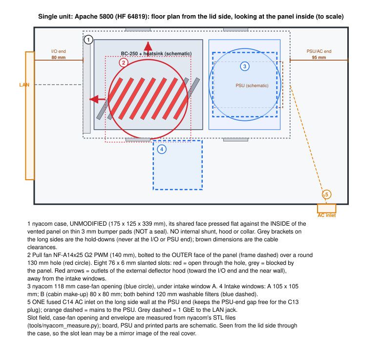

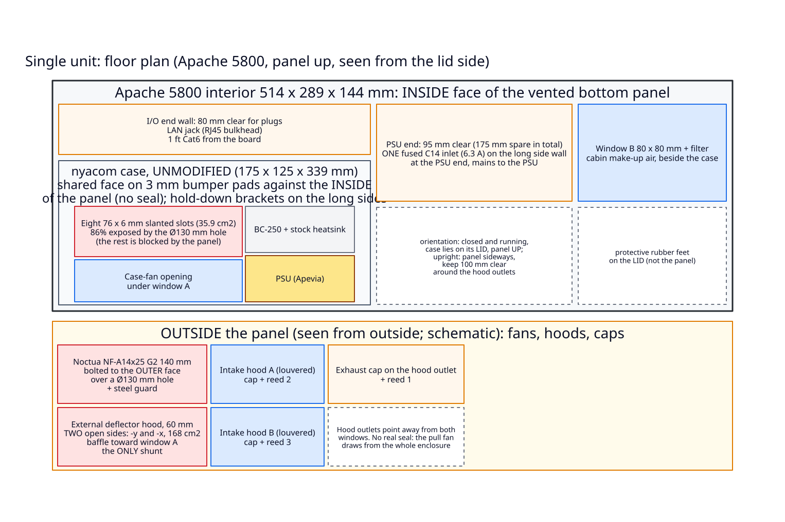

D2 source: [d2-single-layout.d2](diagrams/d2-single-layout.d2)

The Apache 5800 interior and the cut-outs are drawn **to scale** as seen from the lid side, looking at the **inside** of the panel (`tools/make_svgs.py`). The fan frame is on the **outer** face (dashed). The **eight slots are drawn at their measured size, pitch and lean**: **red** where the Ø130 mm hole opens them, **grey** where the panel blocks them. The slant may be a mirror image of the real cover (the STL handedness against the assembled orientation is not confirmed). Board, PSU and printed parts are **schematic**. Brown dimensions are the **80 mm I/O-end** and **95 mm PSU-end** clearances; the grey brackets on the long sides are the hold-downs. The tight Apache 4800 variant is `single-layout-top-apache4800.svg`.

### Airflow

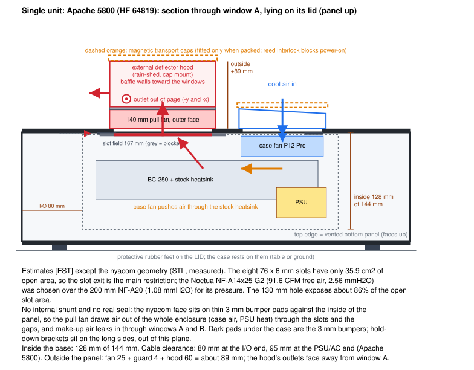

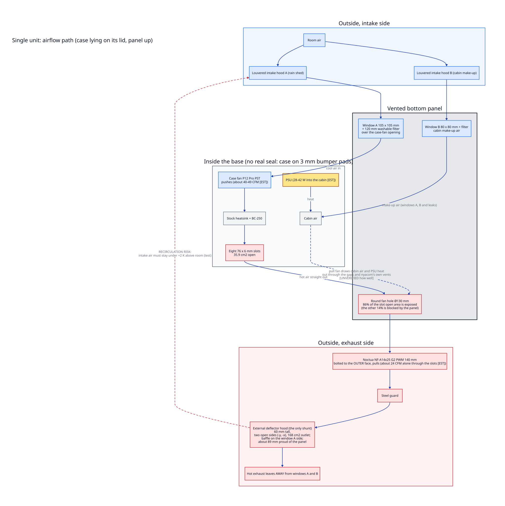

D2 source: [d2-single-airflow.d2](diagrams/d2-single-airflow.d2)

Path (case lying on its lid, panel up): cool air enters window A straight into the nyacom case fan, which pushes it through the stock heatsink. The hot air leaves through the slots that the round hole opens, and the Noctua pulls it through the guard into the **external hood**, which sends it away from the windows. Window B is the cabin make-up window. There is no real seal, so the pull fan also draws cabin air and PSU heat out of the whole enclosure **[UNVERIFIED, test with a tissue or smoke stick]**.

### Power wiring

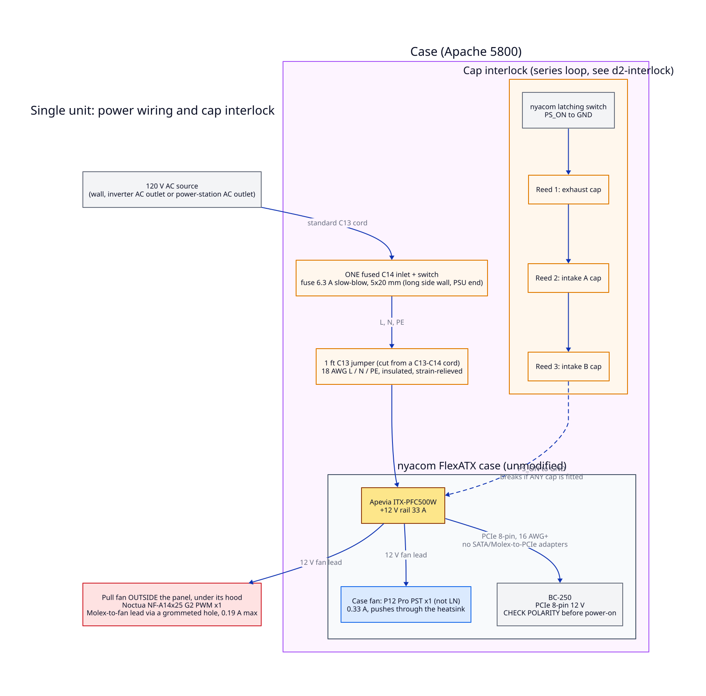

D2 source: [d2-single-power.d2](diagrams/d2-single-power.d2)

- **One AC entry**, as in HARDWARE.md. The C14 module's fuse is **6.3 A slow-blow, 5x20 mm**. The 12 V side is the PSU's PCIe 8-pin to the board, **16 AWG or heavier, no SATA/Molex-to-PCIe adapters, polarity checked with a multimeter before first power-on**.
- **Mains wiring needs a qualified person.** Insulate every terminal, add strain relief, bond earth, fit the printed finger guard. The jumper is a Kentek 1 ft C13-C14 cord with the **C14 end cut off** wired to the inlet module.
- **Fans** run from the PSU's 12 V (the case fan as in nyacom's build; the Noctua via the Molex lead through a grommeted hole). Total fan load about **0.5 A at 12 V**.
- **Board on/off:** nyacom's design uses the BC-250's auto power-on plus a latching switch from PS_ON to GND. The **three cap reed switches** are wired **in series with that switch**.

### Network wiring

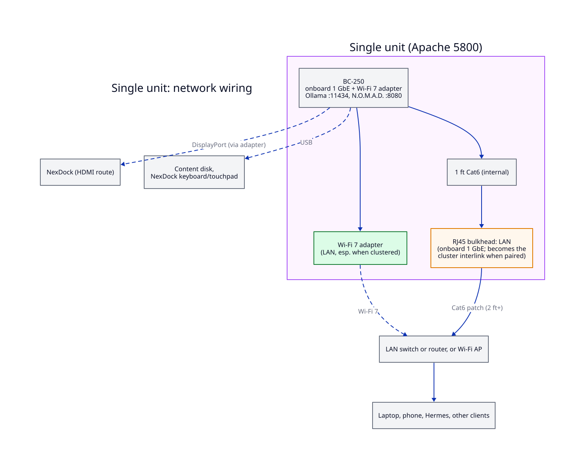

D2 source: [d2-single-network.d2](diagrams/d2-single-network.d2)

Standalone unit: the **onboard 1 GbE** goes to the LAN through an RJ45 bulkhead (1 ft internal Cat6, external patch to the router), **or** the board's **Wi-Fi 7 adapter** carries the LAN (the path already in use on Stefan's first board). Ollama stays on `:11434` and N.O.M.A.D. on `:8080`, LAN only. When two units are clustered on the **default 1G interlink**, the onboard port is the cluster cable and LAN moves to the Wi-Fi 7 adapter. **Never run cluster (RPC) traffic over Wi-Fi.**

**PSU caution.** On the Apevia listing, Amazon's review summary reports reliability complaints (25 of 28 reviewers who mention reliability were negative) and the listing is inconsistent about its fan size. nyacom designed and tested the case around it, so it stays the default; **buy a spare**.

## BOM (single unit)

Full table with links: [diagrams/bom-single.csv](diagrams/bom-single.csv). "Verified" means the page was opened Nov 17, 2026 and showed that price.

| # | Part | Qty | Purpose | Link | Price (USD) | Notes |
|---|---|---|---|---|---|---|
| 1 | ASRock/AMD BC-250 board | 1 | Compute | none | owned | 2nd board ordered by owner |
| 2 | nyacom FlexATX case kit v2.4 (UNMODIFIED) | 1 | Board + PSU housing; one fan through the stock heatsink | [Printables](https://www.printables.com/model/1737913), [Buy the printed kit on eBay (slotted-cover variant used in Pithos)](https://www.ebay.com/itm/236997099720?var=537406080449) | unverified (seller's printed kit; price not checked) | Printables STLs are free, CC BY-NC-SA non-commercial (the page blocks plain fetches (403) but the public API serves the files). The eBay link is the seller's printed kit, slotted-cover variant used in Pithos; buying it supports the seller. Price not checked on this variant. Envelope 175 x 125 x 339 mm MEASURED from the STLs (tools/nyacom_measure.py). Not cut or modified. |
| 3 | ARCTIC P12 Pro PST 120mm (case fan, not LN) | 1 | The one board fan, inside the nyacom case | [B0DJDBV48H](https://www.amazon.com/dp/B0DJDBV48H) | 6.49 verified | Included with nyacom kit if FAN option chosen. Low stock. |
| 4 | Apevia ITX-PFC500W PSU | 1 | 12V power | [B0CWN59YCZ](https://www.amazon.com/dp/B0CWN59YCZ) | 49.99 verified | 12V 33A. Listing: 80mm fan in title, 40mm in specs. Reliability complaints in review summary. Buy a spare. |
| 5 | Apache 5800 rolling carry-on case SKU 64819 | 1 | The case | [Harbor Freight](https://www.harborfreight.com/5800-weatherproof-protective-rolling-carry-on-case-x-large-64819.html) | 89.99 verified | Interior 20-1/4 x 11-3/8 x 5-11/16 in = 514 x 289 x 144 mm (listing). Rolling handle/wheels and any lid pockets NOT checked against the stack. Lid/base split not published. Bottom panel cut for the fan and two windows; lid stays intact. Tight alternative: Apache 4800 (HF 64250, 59.99, 454 x 327 x 168), zero length margin at the minimum clearances. |
| 6 | Noctua NF-A14x25 G2 PWM 140mm (pull fan) | 1 | Bolted to the bottom panel over a round 130 mm hole | [B0DDY14DQD](https://www.amazon.com/dp/B0DDY14DQD) | 44.95 verified | 91.6 CFM, 2.56 mmH2O, 1500 rpm, 24.8 dB(A) max, 2.28 W, 140x140x25 mm, holes 124.5 mm. Chosen over the 200 mm NF-A20 (1.08 mmH2O) because the slots restrict flow. |
| 7 | Noctua NA-FG1-14 Sx2 grill, 140 mm (2 pcs) | 1 | Outer guard under the hood | [B0B2158PLM](https://www.amazon.com/dp/B0B2158PLM) | 14.9 verified | Steel, screws included. One pack covers two units. |
| 8 | 120 mm washable magnetic dust filter, 4-pack (F&Y) | 1 | Intake windows | [B0F5P68T6T](https://www.amazon.com/dp/B0F5P68T6T) | 11.56 verified | Panel is polypropylene (not magnetic): screw/glue to the printed bezel, 105 mm hole spacing. Open area not stated. |
| 9 | C14 inlet module w/ fuse holder + rocker switch (Aexit) | 1 | Single fused AC entry | [B07L6B5C4W](https://www.amazon.com/dp/B07L6B5C4W) | 6.72 verified | 10A listed; fuse not included; confirm switch rating. |
| 10 | T6.3AL250V 5x20mm slow-blow fuses 20-pack (Chanzon) | 1 | Inlet fuse | [B083R41SPY](https://www.amazon.com/dp/B083R41SPY) | 5.49 verified | One pack covers two units. |
| 11 | Kentek 1ft C13-C14 cord 18AWG | 1 | Cut C14 end; internal jumper to PSU | [B07KS52PKL](https://www.amazon.com/dp/B07KS52PKL) | 8.39 verified | Mains wiring by a qualified person. |
| 12 | RJ45 CAT6 bulkhead coupler 2-pack (UMLIFE) | 1 | LAN jack (2-pack also supplies a CLUSTER jack for the optional 5GbE upgrade) | [B07V317BYF](https://www.amazon.com/dp/B07V317BYF) | 11.99 verified | qty = packs. IP67 only with cap fitted. |
| 13 | Cable Matters Cat6 1ft (internal) | 1 | Board to bulkhead jack | [B0B57RBJ3C](https://www.amazon.com/dp/B0B57RBJ3C) | 6.29 verified |  |
| 14 | Cable Matters Cat6 2ft (external LAN) | 1 | LAN jack to router/switch | [B0CP9WYXKS](https://www.amazon.com/dp/B0CP9WYXKS) | 6.39 verified | Any length works. |
| 15 | OPSFALCON Molex-to-2x fan power lead, 2 pack | 1 | 12 V from the PSU's Molex plug to each Noctua pull fan (PWM pin left open = full speed) | [B07JHDQPQN](https://www.amazon.com/dp/B07JHDQPQN) | 7.99 verified | 10 in. Check the PSU's 4-pin Molex plugs (listing says two). A 4-pin Molex has only 2 live wires. |
| 16 | uxcell MC-38 NO reed switch + magnet, 3-pack | 1 | Cap interlock: all 3 reeds of a board in series with its PS_ON switch (cap fitted = magnet near = open) | [B07F669GD1](https://www.amazon.com/dp/B07F669GD1) | 16.29 verified | NO = open while the magnet is near (the listing's definition). 0.5 A max: fine for PS_ON. Actuation about 10 mm. 3.7 stars / 56 ratings. |
| 17 | Neodymium disc magnets 8 x 2 mm, 100 pack (rhinocats) | 1 | Cap and bezel magnets (same size nyacom uses) | [B0DMDVMWLS](https://www.amazon.com/dp/B0DMDVMWLS) | 8.99 verified | N52 not stated. |
| 18 | PHS self-adhesive rubber bumpers 1 in square, 60 pack | 1 | Protective feet on the LID (case rests on its lid); optional standoffs on the vented panel for upright use | [B01N25G0NV](https://www.amazon.com/dp/B01N25G0NV) | 21.86 verified | Only the 60-pack price was verified; any 1 in adhesive bumper works. 10 left in stock. |
| 19 | Printed parts (PETG/ASA): external exhaust deflector hood, hold-down brackets, intake bezels + louvered intake hoods, transport caps | set x1 | Hood = rain shed + baffles toward the intake windows + cap mount; it is the ONLY shunt (no internal shunt, hood or collar). Starting points: MakerWorld 140-120 mm rain shroud (links in HARDWARE-SINGLE.md) | none | **TBD** | filament; PETG or ASA outdoors (PLA softens at about 55-60 C). Hood outlet area at least 110 cm2 (140 mm fan); about 60 mm tall |
| 20 | Bumper pads, 3 mm closed-cell foam or rubber sheet | 1 | Four small pads (about 25 x 25 mm) between the nyacom shared face and the inside of the panel, for vibration only. NOT a seal | none | **TBD** | Optional. Same sheet can cut the hood and cap seats. Do not make a continuous frame: the pull fan should draw from the whole enclosure |
| 21 | Fan hardware: M4 x 40 mm screws + nuts (fan, hood foot, panel) | 1 set | Bolt the pull fan and its hood to the OUTER face of the panel | none | **TBD** | Noctua fan screws are for 25-30 mm stacks only. Nuts sit inside the base between the panel and the nyacom face: use low-profile nuts or inserts, or move the pads clear of them |
| 22 | Hole cutter: round Ø130 mm (jigsaw, circle cutter or bi-metal adjustable cutter) + 105 mm and 80 mm square cut-outs | 1 set | Cut the bottom panel once | none | **TBD** | No verified tool chosen |
| 23 | NVMe SSD 1TB | 1 | OS and models | none | **TBD** | as HARDWARE.md |
| 24 | Content disk 2TB+ | 1 | N.O.M.A.D. library | none | **TBD** | as HARDWARE.md |
| 25 | Thermal pads/plate for rear GDDR6 | 1 | Back-side memory cooling | none | **TBD** | No VRAM/VRM sensors |
| 26 | USB + video panel pass-throughs | 1 | Keyboard/display (NexDock) | none | **TBD** |  |
| 27 | Optional PWM fan controller or 12 V speed knob (e.g. Noctua NA-FC1) | 0-1 | Quieter pull fans at low load | none | **TBD** | Not needed for the first closed-case test; run the pull fan at full 1500 rpm first |
| 28 | Fan tach / over-temperature watchdog (software on each board; optional nice-to-have) | 1 | Optional alert if a pull fan stalls | none | **TBD** | Nice to have, not required: the board's own thermal throttle still applies. See Open questions |

**Verified subtotal (rows 3-18): 318.28 USD per unit** (288.28 with the Apache 4800). This **excludes** the board, the nyacom kit or filament, spares and every TBD row. Packs that cover two units (fuse, filters, grills, Molex leads, magnets, feet) are counted in full here.

## Clustering atomic units

Units **can still be clustered over the network** (llama.cpp RPC), as in HARDWARE.md and `ARCHITECTURE.md` section 6, but **clustering is optional**. **This does not change a unit's physical design**: each unit stays a complete standalone case with its own AC inlet, pull fan and windows, and is useful on its own. The default two-unit interlink uses the **onboard 1G ports** and one short Cat6; LAN moves to each board's **Wi-Fi 7 adapter**. A second jack (already in the single-unit UMLIFE 2-pack) and a **USB 5GbE adapter** are added only if you take the optional upgrade.

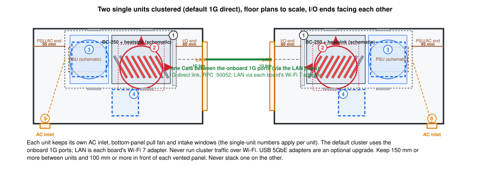

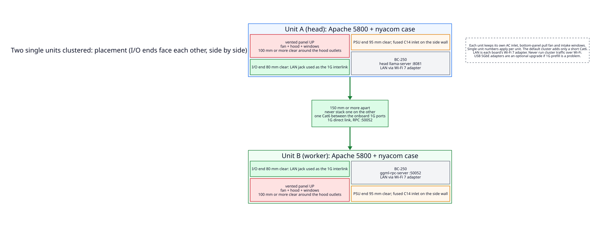

D2 source: [d2-cluster-two-units-layout.d2](diagrams/d2-cluster-two-units-layout.d2)

- **Placement:** side by side, I/O ends facing each other, **150 mm or more apart**, each panel facing up with **100 mm or more** clear around the hood outlets. **Never stack** one on the other. Thermally the units are independent.
- **Two units, default: a 1G direct cable, no switch, no extra adapters.** One Cat6 patch between the two LAN jacks, which are already wired to the boards' onboard 1G ports (the single-unit external LAN cable, BOM row 14, can be reused). Each board's Wi-Fi 7 adapter carries the LAN.

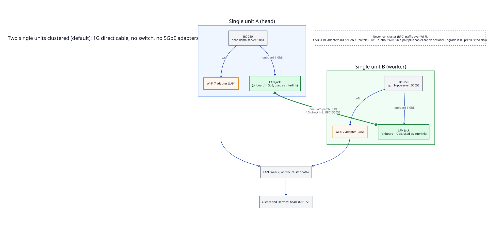

D2 source: [d2-cluster-two-units-network.d2](diagrams/d2-cluster-two-units-network.d2)

**Why 1G is the default.** llama.cpp RPC token generation is limited by **latency, not bandwidth**: each token only sends a few KB between boards. 1G mainly hurts **prompt prefill**, when larger activation tensors cross the link. Benchmark the 1G cable first and upgrade to 5GbE only if prefill is a problem. Community numbers (not measured on this build): [Duonary](https://duonary.com/blog/distributed-llama-cpp-rpc-multi-gpu-nodes/) saw prefill drop below **28 tok/s on 1G** versus **145 tok/s on 2.5G** for a 72B model (Qwen2.5-72B-Instruct Q4_K_M); [4claps' two-board BC-250 cluster](https://github.com/4claps/bc250-llama-cluster) ran Qwen3-30B-A3B at **77.8 tok/s generation** and **72.5 tok/s prompt processing** over 2.5GbE. The model target here is **Qwen3.6 35B MoE** (about 23 GB at Q4), which is smaller than that 72B figure, so 1G prefill may be acceptable. **Never run cluster traffic over Wi-Fi** (latency jitter makes time-to-first-token poor; Duonary makes the same point).

- **Optional upgrade, two units: USB 5GbE adapters.** One [ULANSeN RTL8157](https://www.amazon.com/dp/B0DYJRP97L) per unit (Realtek chip; about **60 USD for a pair**), plus a short internal Cat6 from each adapter to the second bulkhead jack (the CLUSTER jack already in the 2-pack) and one Cat6 between those jacks (reuse the 1G cable if you already bought it). The onboard 1G can then go back to a wired LAN if you want it. Upgrade only after a 1G prefill benchmark says you need it.
- **Three or more units: those 5GbE adapters plus a switch with real 5GBASE-T ports.** The RTL8157 adapter negotiates 100M/1G/2.5G/**5G**. A switch must therefore have **multi-gig copper ports that include 5G** (typically sold as "10G multi-gig" RJ45). Many "2.5G" switches (for example the NETGEAR MS305 and MS108EUP) top out at 2.5G and are **not** suitable if the goal is 5G: the link would drop to 2.5G. Only the cluster (RPC) traffic goes through the switch; each unit's onboard 1 GbE LAN jack (or its Wi-Fi 7 adapter) still carries client traffic. A cheap 1G switch between the onboard ports would also cluster three or more units at the default 1G speed (LAN on Wi-Fi 7, no adapters); that path is not priced here. The recommended 3+ setup, once you want faster prefill, is the Flex XG plus the 5GbE adapters.

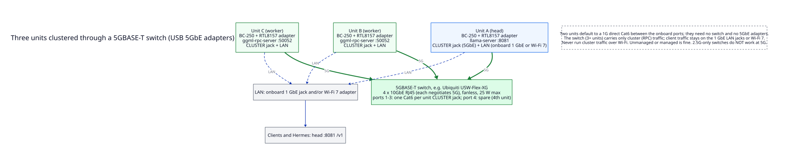

D2 source: [d2-cluster-three-units-network.d2](diagrams/d2-cluster-three-units-network.d2)

### Switch options (Ubiquiti first, then NETGEAR, then one other brand)

Prices and specs read on **Nov 17, 2026**; links resolved on that day (HTTP 200). These switches are for **three or more units** (or a two-unit 5GbE upgrade that you later grow); two units on the default 1G link need no switch.

| Option | 5G ports | Ports | Cooling | Power | Managed | Price | Verdict |
|---|---|---|---|---|---|---|---|
| **1. Ubiquiti UniFi Flex 10 GbE (USW-Flex-XG)**, [store page](https://store.ui.com/us/en/products/usw-flex-xg), [tech specs](https://techspecs.ui.com/unifi/switching/usw-flex-xg) | **All 4 RJ45 10GbE ports** (multi-rate, include 5G) | 4 x 10GbE RJ45 + 1 x 1GbE RJ45, 82 Gbps switching | **Fanless** (compact polycarbonate desktop, 135 x 185 x 32 mm) | **25 W max**; powered by PoE+ or **USB-C 5 V / 5 A**; whether a power adapter ships in the box is **UNVERIFIED** | Managed (UniFi Network app) | **299.00** (store also shows "$329.00 Surcharge incl."; confirm at checkout) | **Recommended.** 3 units at 5G plus a spare port (a 4th unit). |
| **2. NETGEAR XS505M**, [Amazon B075Q5C3Z4](https://www.amazon.com/dp/B075Q5C3Z4), [NETGEAR page](https://www.netgear.com/business/wired/switches/unmanaged/xs505m/) | **All 4 RJ45 ports** (100M/1G/2.5G/5G/10G) | 4 x multi-gig RJ45 + 1 x SFP+ combo | **1 low-noise active fan** per the datasheet, 28.8 dBA at 25 C (some Amazon bullets say "fanless"; the datasheet wins) | 22.5 W max, external AC adapter | **Unmanaged** | **569.99** on Amazon (1 left, third-party seller); about 379.99-438 at other retailers in search results (not link-checked) | Works and is unmanaged, but the most expensive and has a fan. |
| **3. NETGEAR GS110EMX**, [Amazon B0765ZPY18](https://www.amazon.com/dp/B0765ZPY18) | **Only 2 of 10 ports** (the two multi-gig 10G RJ45 ports) | 8 x 1G + 2 x multi-gig RJ45 | Fanless | about 15.6 W max (earlier read, not re-verified) | Web-managed ("Plus") | The Amazon link is a used unit at 322.89; new about 269.99-289.99 elsewhere (search results, not link-checked); an earlier 219.99 read was **not reproduced** | **Does not work for 3 units at 5G** (2 ports). Only for 2 units, which need no switch. Listed for completeness. |
| **Other brand, clearly cheaper: MikroTik CRS304-4XG-IN** (Latvia), [maker page](https://mikrotik.com/product/crs304_4xg_in) | **All 4 RJ45 ports** (1G/2.5G/5G/10G) | 4 x multi-gig RJ45 + 1 x 1G management | **Fanless**, passive | 21 W max | Managed (RouterOS / SwOS; needs a bridge set-up) | MSRP **199.00** on the maker's page; resellers about 161-179 in search results (not link-checked) | Cheapest 4 x 5G option and not Chinese; more configuration work than the UniFi. |

**Ubiquiti desktop line, result (owner question).** **Only the Flex 10 GbE (USW-Flex-XG) has 5G-capable RJ45 ports** (4 of its 5 ports are 10GbE RJ45 multi-rate and therefore do 5G). The other desktop models checked (Flex Mini, Flex Mini 2.5G, Flex 2.5G / Flex 2.5G PoE, Flex, Ultra, Lite) have **1G or 2.5G copper** only and do not qualify; the Pro Max line was judged from listings (2.5G copper plus SFP+ uplinks) and not read in detail. Only the Flex XG's specs (ports, 25 W, USB-C/PoE+ power, polycarbonate desktop body, heat dissipation 85.3 BTU/hr) were read in full from the ui.com tech specs today; its page lists no fan.

**Not recommended:** NETGEAR MS305 / MS108EUP and every 2.5G-only switch (no 5G); NETGEAR MS510TXUP (a PoE managed switch at about 689.99, overkill, fan not checked); NETGEAR XS508M (not checked in detail).

### Cluster add-on BOM

Full table: [diagrams/bom-cluster-addon.csv](diagrams/bom-cluster-addon.csv) (verified Nov 17, 2026 except where noted).

| Tier | Add-on | Notes |
|---|---|---|
| **2 units, 1G direct (default)** | **6.39 USD** = one Cable Matters 2 ft Cat6 between the two LAN jacks | Two units + add-on = **572.16 USD** (2 x 318.28, less one shared copy of the fuse, filter, grill, Molex-lead, magnet and feet packs = 70.79, plus 6.39). The single-unit external LAN cable (BOM row 14) can be reused, in which case the incremental add-on is **0 USD** and the two-unit total is **565.77 USD**. LAN is each board's Wi-Fi 7 adapter. No adapters, no switch. |
| **Optional 5GbE upgrade (2 units)** | **78.95 USD** = 2 adapters (ULANSeN RTL8157, 2 x 29.99, about 60 USD for the pair) + 2 internal 1 ft Cat6 (12.58) + one 2 ft Cat6 between the CLUSTER jacks (6.39) | If you already bought the 1G-default 2 ft cable, reuse it and the upgrade is **72.56 USD**. Two complete single units + this upgrade (no extra 1G cable) = **644.72 USD**. |
| **3 units via a switch** | **427.01 USD** = 3 adapters (89.97) + 3 internal 1 ft Cat6 (18.87) + 3 patch cables (19.17) + Ubiquiti USW-Flex-XG (299.00) | Switch power adapter not priced. A 4th unit adds 42.67 (adapter + 2 cables) on the 4th port. |

### Link details

- **Default 1G link:** the boards' **onboard 1 GbE** ports, already wired to the LAN jacks. One Cat6 between those jacks. No extra adapter.
- **Optional 5GbE adapter:** [ULANSeN RTL8157, 29.99 each](https://www.amazon.com/dp/B0DYJRP97L) (kept as the pick; Realtek chip). Listing rating **3.7 stars from 95 ratings**; the title says 5 Gbps needs a Type-C 3.2 port. On the BC-250's USB-A 3.0 port expect about **3.5 Gbps [EST]**, still about 3.5x the onboard gigabit. Linux support for the RTL8157 was reported in kernel 7.1 **[UNVERIFIED on the BC-250 and on this distro]**. Use the board's **USB 3.0 ports** only.
- **LAN:** on the default 1G cluster, each unit's LAN is its **Wi-Fi 7 adapter**. After a 5GbE upgrade (or on a standalone unit), the onboard 1 GbE can go to its own LAN jack again. Clients and Hermes use the **head's** `llama-server` on `:8081`. (The optional-clustering proposal on origin/main says `:11434` for the head; in cluster mode Ollama is stopped, so `:8081` applies unless that doc changes.)
- **RPC security:** upstream calls RPC insecure. Bind each worker's RPC server **only to the cluster-link address**, never the LAN or the Wi-Fi interface. **Never run cluster traffic over Wi-Fi.** With a switch, put the cluster ports on their own switch (nothing else plugged into it).
- **Example addressing [EST, any private range works]:** head `10.77.5.1/24`, workers `10.77.5.2/24`, `10.77.5.3/24`, no gateway and no default route on the cluster interface. Commands below are fish-friendly (no `VAR=` assignments):

```text
# find the cluster interface name on each box (onboard 1G by default, or the 5GbE adapter if upgraded)
ip -br link
nmcli connection add type ethernet ifname <cluster-iface> con-name pithos-cluster ipv4.method manual ipv4.addresses 10.77.5.1/24 ipv4.never-default yes ipv6.method disabled
# worker:  ggml-rpc-server -H 10.77.5.2 -p 50052 -c
# head (two units):    llama-server --host 0.0.0.0 --port 8081 --rpc 10.77.5.2:50052 -m <model.gguf>
# head (three units):  llama-server --host 0.0.0.0 --port 8081 --rpc 10.77.5.2:50052,10.77.5.3:50052 -m <model.gguf>
```

  The binary name follows ARCHITECTURE.md (`ggml-rpc-server`); some llama.cpp builds name it `rpc-server`. Commands are **[UNVERIFIED on BC-250]** and belong in backlog item 13 (RPC build and units).
- **Mode switching:** in cluster mode Ollama is stopped on every board and Hermes needs its endpoint switched from `:11434` to the head's `:8081`. A software gap, not solved here.

### Brand check (owner rule: no Chinese-headquartered hardware brands)

| Item | Brand and HQ | Chip origin | Action |
|---|---|---|---|
| Switch options above | Ubiquiti (USA), NETGEAR (USA), MikroTik (Latvia) | n/a | TP-Link and every other Chinese-HQ brand were **excluded** from the switch search |
| 5GbE USB adapter (optional upgrade) | **ULANSeN, a Shenzhen, China brand** (Shenzhen Ulanson Electronic Co., Ltd.) | **Realtek RTL8157 (Taiwan)** | **Kept as the optional 5GbE pick** by owner decision (t630u): the chipset is Realtek and the adapter is a generic part. Not in the default 1G two-unit path. |
| PSU | Apevia (headquartered in City of Industry, California, USA, per its about page) | n/a | Kept; a spare is advised for reliability |
| Noctua fan and grill, ARCTIC P12 Pro, Cable Matters, uxcell, Kentek, UMLIFE, Chanzon, F&Y, Aexit, PHS, OPSFALCON, rhinocats | Noctua is Austrian; **the other brands' HQ countries were not checked** (several are generic marketplace brands, likely Chinese-sourced) | n/a | Not replaced (minor parts, per the owner's scale-back); flagged only |

## Considered and dropped: dual-board case

An earlier branch put **two BC-250 systems in one larger hard case** (two unmodified nyacom cases side by side on one panel, one inlet, one internal 5GbE link, two large pull fans). It is **dropped**: the case is large and heavy, the fans and hoods multiply, the floor cut-outs weaken the panel and stock is thin, and it gives **no practical benefit over simply pairing two atomic units** with one Cat6 cable. Pairing keeps each unit small, standalone, separately powered and independently serviceable. The cooling work from that branch (push/pull, external hood, filters, caps, interlock) is kept in the single unit.

## Test protocol before trusting the case closed

Same rule as HARDWARE.md (lid open first, then closed), with numbers to record. All thresholds are **suggestions**, not verified limits.

1. **Lid open, panel up:** run a sustained load (`tools/ollama-bench.sh` in a loop, or llama.cpp) for 30 minutes. Record `sensors`, GPU governor temperature, an IR reading of the backplate and the PSU case, and room temperature.
2. **Lid closed, lying on its lid, panel up, hood on, caps off:** repeat. Stop at **95 C** GPU or if the PSU is too hot to hold.
3. **Compare.** nyacom's open-air result is 76 C (24 CU, 1500 MHz, 28 C ambient). A closed case that adds more than about **8 C [suggested]** over the lid-open run means more flow (try the **classic cover**), more intake area or a different outlet direction.
4. **Airflow and recirculation checks:** hold a tissue or smoke stick (a) at each intake window (should pull inward), (b) at the hood outlets (should blow out, away from the windows), (c) around the nyacom case edges, the panel seam and the lid-base seam (expect **inward draw**), put a thermocouple on the PSU case and in the cabin to confirm the PSU heat is pulled out (compare with the pull fan stopped), and (d) measure the **intake air temperature at windows A and B** against the room (more than about **+2 K** means recirculation). Measure the **exhaust speed at the hood** against the 24 CFM estimate, and the **case fan's speed and the board temperature with and without the pull fan** to see what the slot restriction costs.
5. **Neo vs classic cover:** repeat step 2 with nyacom's classic cover to see what the 2x open area buys.
6. **Fan fail test:** unplug the pull fan (the stalled rotor sits in the only exhaust path) and repeat step 2 at design load. Confirm the case fan alone holds the board below the stop limit; if you fitted the watchdog, confirm it trips.
7. **Orientation test:** repeat step 2 **upright** with the panel sideways, the hood outlet pointing up, **100 mm** from a wall and again at 50 mm. Check the **hold-down brackets** keep the case on the bumper pads with the panel up (tap and shake) and that the hood still sheds a light mist with the outlet turned up.
8. **Interlock test:** with a multimeter on the PS_ON switch terminals, fit each cap in turn: the board must not start and must shut down if a cap goes on while running. Confirm the contact state of every MC-38 before wiring.
9. **Splash/dust check:** with the hood on, spray a light mist from a few directions with the board off and caps off; repeat with caps on. A dust and drip sanity check, not a waterproofing rating.
10. **Cluster:** run two units on the **default 1G direct cable** under a cluster benchmark (the Qwen3.6 35B MoE target if you have it) and record prefill, generation, each board separately, and **wall watts** with a plug-in wattmeter. Measure the 1G link with `iperf3` before blaming the model server. Upgrade to 5GbE and re-test only if prefill is a problem. For three units, measure each 5G link (negotiated speed must show 5000 Mb/s, not 2500) and the USB adapters' temperature.

## Open questions and unverified assumptions

- **Fan choice vs the brief.** The brief asked for the largest fan that fits; the pick is the 140 mm G2 because the measured slots restrict flow (see "Pull fan"). Owner to confirm, or to switch to the classic cover (then the NF-A20 is competitive and quieter).
- **Which cover is on Stefan's case.** The slot geometry is from the **neo** cover; the 76 mm slot length matches it. Confirm against the printed case. The slanted-slot drawing may be a mirror image.
- **Case-fan and board airflow curves** are unverified, so the pull-fan-alone numbers are a floor, not a prediction; closed-case temperatures are unmeasured.
- **Apache 5800 details:** handle channel and wheels versus the 514 mm length, the lid/base split (the 128 mm stack in a 144 mm total interior), pockets in the lid, the real bottom panel's thickness and ribs. The listing's "interior dimensions" are approximate.
- **nyacom mounting points** (screw/leg holes, bracket grip) are blind features that were **not located**; the hold-down brackets are not designed or tested (with the panel up the case hangs from them).
- **External recirculation and cabin heat.** Exhaust and intake sit 36 mm apart on one panel; the hood baffles and the outlet direction are the only separation. PSU and shell heat (28-42 W) leave through the gaps; a **dedicated cabin exhaust** is the fallback if the cabin runs hot.
- **End clearance and plug sizes** are typical-plug estimates, not the BC-250's measured port layout or the real cables. The 5800 has **zero spare** at the recommended 80 + 95 mm.
- **Pull-fan failure alerting** (optional) is not designed. **Interlock:** a welded reed defeats it; PS_ON wiring was not checked on a build; the cap plates are **TBD**.
- **Printed cover parts:** only the two MakerWorld shrouds were read; the Printables pages returned 403/500.
- **Heat load and wall power:** 130-145 W [EST] at the wall under a 110-112 W APU load, up to 370 W at 40-CU unlocked peak; these are estimates. Measure idle and load with a plug-in wattmeter (not TP-Link). **Inlet module switch rating:** the listing says 10 A for the module; confirm on arrival.
- **Default 1G cluster prefill** on Qwen3.6 35B MoE is unverified on these boards; the Duonary and 4claps figures are community measurements on other models and links.
- **Switch (3+ units only):** Flex XG price ($299 vs "$329 Surcharge incl."), whether the USB-C power adapter ships, and the retailer prices quoted from search results are unverified. The Flex XG must negotiate **5G** (not 2.5G) with the RTL8157 in practice: test.
- **RTL8157** (optional 5GbE upgrade) on the BC-250's USB 3.0 port, kernel support and the 3.5 Gbps figure are unverified. The adapter listing has only 95 ratings (3.7 stars).
- **PSU reliability** (see caution) and the 80 mm vs 40 mm fan discrepancy on the Apevia listing.
- **Hermes endpoint.** `:8081` (ARCHITECTURE.md) vs `:11434` (the origin/main clustering proposal). Needs a decision.
- **Repository state.** The local clone is Arch/Rocky-based and has **diverged** from origin/main (Debian 13-based, with an added clustering proposal). HARDWARE.md is identical in both. Rebase this file onto origin/main before committing.

## Sources

- nyacom case: [Printables 1737913](https://www.printables.com/model/1737913) (CC BY-NC-SA; STL files read through `api.printables.com/graphql/`; description via the [3dgo mirror](https://3dgo.app/models/printables/1737913): single P12 Pro, FurMark results, FlexATX/Apevia design), [printed kit from the seller on eBay, slotted-cover variant](https://www.ebay.com/itm/236997099720?var=537406080449) — buying the printed kit supports the seller. Measurements: `tools/nyacom_measure.py`.
- Cases: [Apache 5800 (Harbor Freight 64819)](https://www.harborfreight.com/5800-weatherproof-protective-rolling-carry-on-case-x-large-64819.html) (interior 20-1/4 x 11-3/8 x 5-11/16 in, 89.99, read Nov 17, 2026), [Apache 4800 (64250)](https://www.harborfreight.com/4800-weatherproof-protective-case-x-large-black-64250.html), [NANUK 935 (Amazon B08L9QB6XD)](https://www.amazon.com/dp/B08L9QB6XD), [NANUK 935 page](https://nanuk.com/products/nanuk-935).
- BC-250 specs: [elektricm docs](https://elektricm.github.io/amd-bc250-docs/hardware/specifications/) (board about 310-340 x 115 mm, 220 W TDP, up to 235 W measured).
- Fans: [Noctua NF-A14x25 G2 PWM specs](https://noctua.at/en/nf-a14x25-g2-pwm/specification), [NF-A20 PWM](https://noctua.at/en/nf-a20-pwm/specification), [NF-A14 PWM](https://noctua.at/en/nf-a14-pwm/specification) (read Nov 17, 2026; IP50, locked-rotor protection); [ARCTIC P12 Pro PST datasheet](https://www.arctic.de/media/2c/de/c6/1750758983/Spec_Sheet_P12_Pro_PST_EN.pdf).
- Covers: [MakerWorld 140/120 mm Unrestricted Fan Rain Shroud](https://makerworld.com/en/models/3275345-140-120mm-unrestricted-fan-rain-shroud), [Thingiverse 120mm fan housing with louvers](https://www.thingiverse.com/thing:3217414); earlier Pithos ideas in `/workspace/bc250/PORTABLE.md`.
- Switches: [Ubiquiti Flex 10 GbE store](https://store.ui.com/us/en/products/usw-flex-xg) and [tech specs](https://techspecs.ui.com/unifi/switching/usw-flex-xg); [NETGEAR XS505M](https://www.netgear.com/business/wired/switches/unmanaged/xs505m/) and [Amazon](https://www.amazon.com/dp/B075Q5C3Z4); [NETGEAR GS110EMX on Amazon](https://www.amazon.com/dp/B0765ZPY18); [MikroTik CRS304-4XG-IN](https://mikrotik.com/product/crs304_4xg_in); [Apevia about page](https://www.apevia.com/about-us) (HQ).
- Clustering: Pithos `docs/ARCHITECTURE.md` section 6 and `docs/PROPOSALS/optional-clustering-for-hermes-65k-and-single-box-baseline.md` (origin/main), [llama.cpp RPC](https://github.com/ggml-org/llama.cpp/blob/master/tools/rpc/README.md).
- Cluster-link measurements (community, not this build): [Duonary, llama.cpp RPC on 1G vs 2.5G](https://duonary.com/blog/distributed-llama-cpp-rpc-multi-gpu-nodes/) (Qwen2.5-72B-Instruct Q4_K_M: prefill below 28 tok/s on 1G, 145 tok/s on 2.5G); [4claps/bc250-llama-cluster](https://github.com/4claps/bc250-llama-cluster) (two BC-250s, Qwen3-30B-A3B Q4_K_M over 2.5GbE: 77.8 tok/s generation, 72.5 tok/s prompt processing).
